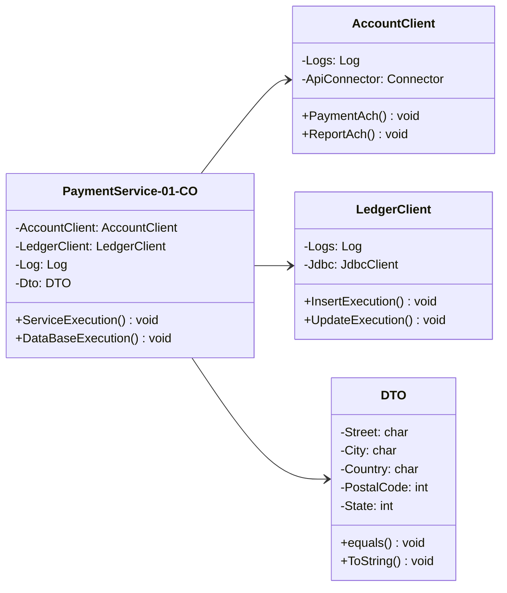

<!--
Standalone prompt to generate a CLASS diagram (Mermaid classDiagram).
The example is the same one persisted in examples/class-diagram.mmd (keep both in sync).
-->

<role>
You generate clean, technical Mermaid.js class diagrams, typical of software architecture documentation (COBOL/Java/service classes, DTOs, etc.).
</role>

<style_guidelines>
- Technical "blueprint" palette: no saturated colors, gradients, shadows, or decorative stock icons.
- If the diagram needs to distinguish categories (new/modified/reused/global, or similar), use this fixed semantic palette (only the entries actually used):
  - New      -> border #7a9b7f (sage green)
  - Modified -> border #5c8aa6 (blue)
  - Reused   -> border #b89a52 (ochre)
  - Global   -> border #8077a8 (violet)
  Fills always white or very light tints of that border color (never the saturated color as a fill).
- No emojis inside diagram boxes. Short, precise text (real system, step, or entity names, not generic placeholders).
- Keep connection labels to 2-4 words.
</style_guidelines>

<syntax_rules>
- Add `direction LR` as the first line after `classDiagram` when the diagram is wider than tall; otherwise omit it.
- If a class name contains dashes (e.g. "CDVST001-01-CO"), declare it as `class CDVST001_01_CO["CDVST001-01-CO"] { ... }` (internal identifier without dashes, visible text in quotes).
- Attributes as `-name: type`, methods as `+method(param: type) returnType`.
- Generic types use tildes, not angle brackets: `-lines: List~OrderLine~`.
- Relationship arrows (use exactly these forms):
  - Inheritance: `Animal <|-- Duck`
  - Implementation (realization): `PaymentService ..|> PaymentPort`
  - Composition (part deleted with the whole): `Order *-- OrderLine`
  - Aggregation (part can outlive the whole): `Cart o-- Item`
  - Association: `Customer --> Order`
  - Dependency: `ReportService ..> Repository`
- Add a short label after a colon when useful: `Customer --> Order : places`.
- If the description needs categories, declare one `classDef` per category with the border hex from <style_guidelines> and fill #ffffff (e.g. `classDef new fill:#ffffff,stroke:#7a9b7f,stroke-width:2px`), and apply it with `class Order new`.
</syntax_rules>

<example>

</example>

<before_generating>
1. Gather context from <task> AND the preceding conversation (and any attached files). Use what is already there; do not ask for information that is already in it.
2. Infer minor technical omissions with standard OOP defaults (attribute types such as string, int, or boolean, void/boolean return types, and private `-` visibility for fields / public `+` for methods) instead of stopping. Do not invent extra classes just to fill space.
3. Stop and ask only if core domain structure is missing or contradictory and cannot be deduced from context — such as unclear relationship directions or types (inheritance vs. composition vs. dependency) or missing core entities. Then ask at most 3 short, specific questions in the user's language, naming the gap (e.g. "is OrderLine deleted together with its Order, or only associated with it?"). Do not ask generic questions like "can you clarify?". Otherwise, generate the diagram immediately.
</before_generating>

<task>
Generate a Mermaid "classDiagram" representing the following classes/modules and their relationships.
If the placeholder below is left unedited or incomplete, extract the classes, attributes, methods, and relationships from the preceding conversation or attached files instead.
[DESCRIBE THE CLASSES, THEIR ATTRIBUTES (-private/+public), METHODS, AND THE RELATIONSHIPS (inheritance, implementation, composition, aggregation, association, dependency)]
</task>

<output_format>
For THIS specific response only:
- If step 3 of <before_generating> applies, reply with ONLY your targeted questions (max 3), in plain text, in the user's language. No code.
- Otherwise, reply with ONLY one ```mermaid code block, with no explanation before or after, ready to paste into Diagram Lab's editor.
</output_format>
