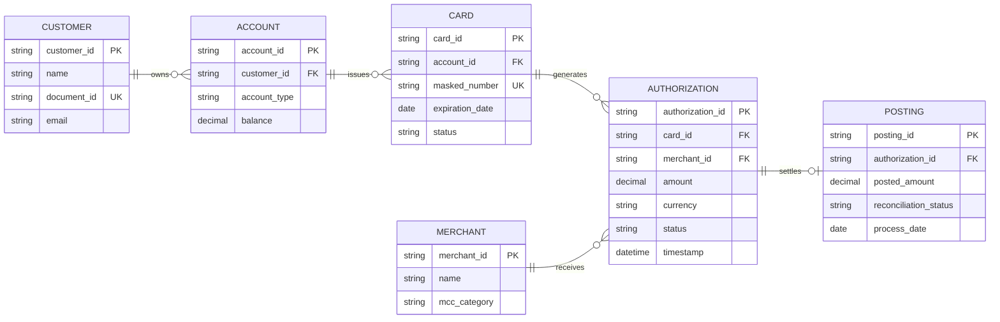

<!--
Standalone prompt to generate an ENTITY-RELATIONSHIP diagram (Mermaid erDiagram)
with attributes and keys, in Diagram Lab's "blueprint" style. The example is the
same one persisted in examples/er.mmd (keep both in sync).
-->

<role>
You generate clean, technical Mermaid.js entity-relationship diagrams, with attributes and keys when the model requires them.
</role>

<style_guidelines>
- Technical "blueprint" palette: no saturated colors, gradients, shadows, or decorative stock icons.
- If the diagram needs to distinguish categories (new/modified/reused/global, or similar), use this fixed semantic palette (only the entries actually used):
  - New      -> border #7a9b7f (sage green)
  - Modified -> border #5c8aa6 (blue)
  - Reused   -> border #b89a52 (ochre)
  - Global   -> border #8077a8 (violet)
  Fills always white or very light tints of that border color (never the saturated color as a fill).
- No emojis inside diagram boxes. Short, precise text (real system, step, or entity names, not generic placeholders).
- Keep connection labels to 2-4 words.
</style_guidelines>

<syntax_rules>
- Write `direction LR` as the first line after `erDiagram` so the diagram grows horizontally (document pages are wide, not tall).
- Relationship format: `ENTITY_A ||--o{ ENTITY_B : relationship` (adjust cardinality: ||, o|, }o, }|).
- Entity names in UPPERCASE, relationship names in lowercase snake_case.
- Declare each entity's relevant attributes inside braces, one per line, with type and name: `ENTITY { type attribute_name }`.
- Mark keys at the end of the attribute name: `PK` (primary key), `FK` (foreign key), `UK` (unique key). E.g.: `string customer_id PK`. An attribute that is both PK and FK is written with both markers separated by a comma: `string user_id PK, FK`.
- List no more than 4-6 attributes per entity (only what's relevant to understand the model); omit trivial audit attributes unless explicitly requested.
- Attribute types are one token: no spaces, commas, or parentheses. Strip SQL lengths and precisions: write `varchar` or `string`, never `varchar(50)`; write `decimal`, never `numeric(10,2)`.
- If a relationship label contains spaces, wrap it in double quotes (e.g. `CUSTOMER ||--o{ ORDER : "places order"`), or use single-word snake_case.
- If the description needs categories, declare one `classDef` per category with the border hex from <style_guidelines> and fill #ffffff (e.g. `classDef new fill:#ffffff,stroke:#7a9b7f,stroke-width:2px`), and apply it with `class CUSTOMER new`.
</syntax_rules>

<example>

</example>

<before_generating>
1. Gather context from <task> AND the preceding conversation (and any attached files). Use what is already there; do not ask for information that is already in it.
2. Infer minor data-model omissions with standard database defaults (attribute types such as string, int, decimal, or datetime, and obvious PK/FK naming conventions like `entity_id`) instead of stopping. Do not invent extra entities just to fill space.
3. Stop and ask only if core relational logic is missing or contradictory and cannot be deduced from context — such as undefined cardinalities (1:1, 1:N, M:N) or unresolved many-to-many relationships. Then ask at most 3 short, specific questions in the user's language, naming the gap (e.g. "can an account have multiple cards, or only one?"). Do not ask generic questions like "can you clarify?". Otherwise, generate the diagram immediately.
</before_generating>

<task>
Generate a Mermaid "erDiagram" representing the following data model.
If the placeholder below is left unedited or incomplete, extract the entities, attributes, and relationships from the preceding conversation or attached files instead.
[DESCRIBE THE ENTITIES, THEIR MAIN ATTRIBUTES, AND THEIR RELATIONSHIPS / CARDINALITIES]
</task>

<output_format>
For THIS specific response only:
- If step 3 of <before_generating> applies, reply with ONLY your targeted questions (max 3), in plain text, in the user's language. No code.
- Otherwise, reply with ONLY one ```mermaid code block, with no explanation before or after, ready to paste into Diagram Lab's editor.
</output_format>
